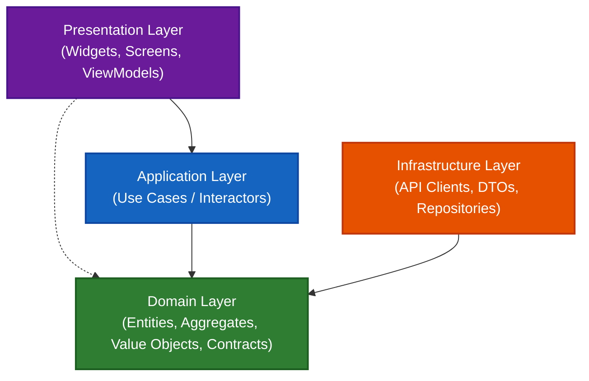
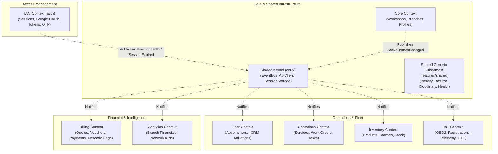
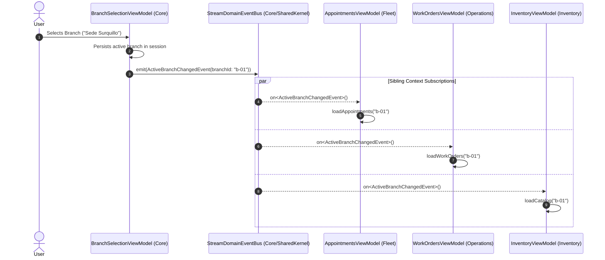
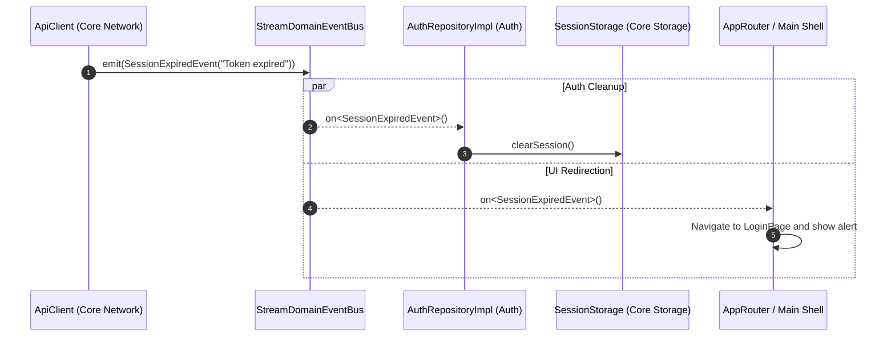

# ShiftIQ Mobile Architecture: Domain-Driven Design (DDD) & Clean Architecture

## 1. Executive Summary

The ShiftIQ mobile application is engineered following **Clean Architecture (Onion Architecture)** combined with tactical and strategic patterns from **Domain-Driven Design (DDD)**. The system is partitioned into autonomous **Bounded Contexts**, ensuring strict domain purity, high cohesion, low coupling, and predictable scalability.

Cross-cutting concerns and cross-context communication rely on **In-Memory Domain Events** driven by pure Dart Streams and a sealed event hierarchy, eliminating direct compile-time coupling between sibling features.

---

## 2. Concentric Layer Structure

Every feature module representing a Bounded Context (`lib/features/<context>/`) strictly adheres to concentric layers:

```
lib/features/<context>/
├── domain/                  # Enterprise business rules, Entities, Aggregates, Value Objects, Repository Interfaces
│   ├── model/               # Pure business models and immutable records (Zero Flutter/framework imports)
│   ├── repositories/        # Repository contracts / Output Ports
│   └── <context>_domain.dart# Barrel file defining the public domain surface
├── application/             # Application business rules, Use Cases / Interactors
│   └── usecases/            # Command and query orchestrators (e.g., ManageWorkOrders, CreateAppointment)
├── infrastructure/          # Framework adapters, external services, network clients, persistence
│   ├── remote/              # HTTP clients (Api services) and Wire DTOs
│   │   └── dtos/            # Data Transfer Objects with Dart 3 pattern matching deserialization
│   └── repositories/        # Concrete Repository implementations implementing domain contracts
└── presentation/            # User Interface layer (Flutter Widgets, Screens, ViewModels)
    ├── controllers/         # State management controllers (ChangeNotifier / ViewModels)
    ├── views/               # Screen widgets
    └── widgets/             # Reusable context-specific UI components
```

### Layer Dependency Invariants



1. **Inward Dependency Rule**: Dependencies flow strictly inward toward the `domain/` core.
2. **Domain Purity**: The `domain/` layer contains **zero** framework imports (`flutter/material.dart`, HTTP clients, storage libraries). It consists solely of pure Dart types, business rules, and contract interfaces.
3. **Repository Inversion (DIP)**: Domain defines abstract repository interfaces (Output Ports). Infrastructure implements them (Adapters), inverted via `get_it` dependency injection.
4. **Barrel Files**: Each domain layer exposes a `<context>_domain.dart` barrel file that encapsulates internal directory structures and exposes a clean public interface.

---

## 3. Bounded Context Map

The application decomposes the automotive workshop and fleet management ecosystem into nine distinct Bounded Contexts:



| Bounded Context | Package | Purpose |
| :--- | :--- | :--- |
| **IAM (Auth)** | `lib/features/auth` | User authentication, token rotation, Google OAuth, email OTP verification, password lifecycle. |
| **Core** | `lib/features/core` | Multi-tenant organization: Workshop management, branch discovery, and polymorphic user profiles (Owner, Employee, Customer). |
| **Fleet** | `lib/features/fleet` | Workshop appointments, bay scheduling, customer branch affiliations, and technician career history. |
| **Operations** | `lib/features/operations` | Service catalog, Work Orders, task progression lifecycle, mechanic assignment, and spare-part reservations. |
| **Inventory** | `lib/features/inventory` | Product catalog, batch tracking, stock replenishment, and branch inventory views. |
| **IoT & Telemetry** | `lib/features/iot` | OBD2 dongle management, vehicle-dongle linking, telemetry snapshot streaming, batch ingestion, and Diagnostic Trouble Code (DTC) alerts. |
| **Billing** | `lib/features/billing` | Quotes calculation, SUNAT electronic vouchers (Boleta / Factura), payment registration, and Mercado Pago checkout integration. |
| **Analytics** | `lib/features/analytics` | Workshop performance metrics, financial revenue summaries, and network-wide executive KPIs. |
| **Shared** | `lib/features/shared` | Generic subdomain: Official Peruvian identity validation (RENIEC / SUNAT / Migraciones via Factiliza), Cloudinary media uploads, and service health monitoring. |

---

## 4. Cross-Context Communication: Local Domain Events

### The Golden Rule of Feature Independence
> **Sibling Bounded Contexts must NEVER import each other directly.**

`feature:billing` must never import `feature:fleet`, nor should `feature:operations` import `feature:core`. Direct feature-to-feature dependencies produce tight coupling, cyclical references, and fragile builds.

Instead, cross-context interactions are orchestrated asynchronously through **In-Memory Domain Events**.

### Domain Event Architecture

The event system is implemented in `lib/core/domain/event/` and `lib/core/infrastructure/event/`:

```
lib/core/
├── domain/event/
│   ├── domain_event.dart        # Base sealed DomainEvent hierarchy
│   └── domain_event_bus.dart    # Abstract event bus interface
└── infrastructure/event/
    └── stream_domain_event_bus.dart # Pure Dart StreamController implementation
```

#### 1. Sealed Domain Event Hierarchy (Dart 3)
```dart
sealed class DomainEvent {
  final String eventId;
  final DateTime occurredOn;
  DomainEvent({String? eventId, DateTime? occurredOn}) : ...;
}

final class ActiveBranchChangedEvent extends DomainEvent {
  final String branchId;
  final String branchName;
  ...
}

final class UserLoggedInEvent extends DomainEvent {
  final String userId;
  final String username;
  final List<String> roles;
  ...
}

final class UserLoggedOutEvent extends DomainEvent {
  final String? userId;
  final String? reason;
  ...
}

final class SessionExpiredEvent extends DomainEvent {
  final String reason;
  ...
}
```

The `sealed` modifier guarantees compile-time exhaustiveness checking in `switch` pattern matching expressions.

#### 2. Stream-Based In-Memory Event Bus
```dart
abstract interface class DomainEventBus {
  void emit(DomainEvent event);
  Stream<T> on<T extends DomainEvent>();
  Future<void> dispose();
}

class StreamDomainEventBus implements DomainEventBus {
  final StreamController<DomainEvent> _controller = StreamController<DomainEvent>.broadcast();

  @override
  void emit(DomainEvent event) => _controller.add(event);

  @override
  Stream<T> on<T extends DomainEvent>() {
    return _controller.stream.where((e) => e is T).cast<T>();
  }
}
```

### Event Flow Scenario 1: Multi-Tenant Branch Switching

When an administrator or mechanic switches their active workshop branch in the Core context, all listening domains automatically re-scope their state without direct coupling:



### Event Flow Scenario 2: Global Session Expiration & Auto-Logout

When a network request receives an HTTP 401 Unauthorized response that cannot be refreshed, the central `ApiClient` dispatches a domain event:



---

## 5. Shared Kernel vs. Generic Subdomain

| Architectural Aspect | Shared Kernel (`lib/core/`) | Generic Subdomain (`lib/features/shared/`) |
| :--- | :--- | :--- |
| **Concept** | Universal domain concepts and utilities shared by all contexts. | Self-contained, standard business capability reusable across industries. |
| **Scope** | Minimalist: `DomainEvent`, `DomainEventBus`, `ApiClient`, `AppException`, `SessionStorage`. | Full bounded context: Official Peruvian identity verification, media file uploads, health checks. |
| **Domain Purity** | High-level contracts and platform-wide building blocks. | Contains complete `domain/`, `application/`, `infrastructure/` layers. |
| **External Dependencies** | Standard Dart/Flutter runtime, HTTP networking, Key-Value storage. | External cloud APIs: **Factiliza** (RENIEC / SUNAT / Migraciones), **Cloudinary**. |
| **Consumption** | Imported directly by features. | Exposed via Use Cases (`ManageIdentityValidations`, `ManageMediaUploads`). |

---

## 6. Tactical Design Patterns

### 1. Robust DTO Parsing with Dart 3 Pattern Matching
Network payloads are deserialized using Dart 3 pattern matching and record destructuring, enforcing strict schema validation before domain entity creation:

```dart
factory AppointmentDto.fromJson(Map<String, dynamic> json) {
  if (json case {
    'id': final String id,
    'branchId': final String branchId,
    'customerId': final String customerId,
    'vehicleId': final String vehicleId,
    'scheduledStart': final String startStr,
  }) {
    return AppointmentDto(
      id: id,
      branchId: branchId,
      customerId: customerId,
      vehicleId: vehicleId,
      scheduledStart: DateTime.tryParse(startStr) ?? DateTime.now(),
      customerName: json['customerName']?.toString() ?? 'Cliente del Taller',
      status: json['status']?.toString() ?? 'PENDING',
      ...
    );
  }
  throw const FormatException('Invalid or missing fields in AppointmentDto JSON');
}
```

### 2. Resilient Repository Implementations
Repositories encapsulate remote HTTP interactions, local fallback storage, and data transformation mappers. If remote network services fail, local cache maintains UI usability while clearly notifying user interfaces:

```dart
class FleetRepositoryImpl implements FleetRepository {
  final AppointmentApi appointmentApi;
  ...
  @override
  Future<List<Appointment>> getAppointments({String? branchId, ...}) async {
    try {
      final rawList = await appointmentApi.getAppointments(branchId: branchId);
      if (rawList.isNotEmpty) {
        return rawList.map((j) => AppointmentDto.fromJson(j).toDomain()).toList();
      }
    } catch (_) {
      // Graceful fallback to cached local appointments
    }
    return _localAppointments.where((a) => a.branchId == branchId).toList();
  }
}
```

### 3. Dependency Injection
All dependencies are registered in `lib/core/di/dependency_injection.dart` using `GetIt`, adhering to the Dependency Inversion Principle. Presentation and Application layers request abstract repository interfaces, leaving infrastructure details completely decoupled.
